# Operating Systems – Worksheet 2

## Introduction

For this worksheet, I worked on building a small operating system using Assembly and C. The main aim was to understand how an operating system starts up, how Assembly and C work together, how text can be displayed using a framebuffer and how keyboard input can be processed.

I completed the work using the UWE CSCT Cloud environment. The main tools I used were NASM, GCC, Make, Git and QEMU.

## Git Branches and Version Control

I used Git and GitHub to keep track of my progress throughout the worksheet. I created separate branches for Part 1 and Part 2 so that I could keep the work organised without overwriting my previous work.

- `main` – Contains my completed Part 1 work.
- `worksheet2-part2` – Contains my Part 2 work, including keyboard input, the input buffer API and the terminal implementation.

To view all the work, it is important to switch between the two branches on GitHub. This allows each part of the worksheet to be viewed separately.

I regularly committed and pushed my changes to GitHub so that my work was saved remotely.

## Project Structure

I organised my project into a few different folders to keep the files separate and easier to manage.

- `source` contains the Assembly loader, kernel, C functions and linker script.
- `drivers` contains the framebuffer, keyboard, interrupt and I/O drivers.
- `iso` contains the GRUB files needed to boot the operating system.
- `screenshots` contains the screenshots showing my implementation and testing.
- `Makefile` contains the commands used to compile and build the operating system.
- `README.md` contains the documentation for the worksheet.

**SS1 – Project structure**


---

# Part 1 – Building the Basic Operating System

## Task 1 – Starting a Tiny Operating System

For Task 1, I started by creating the basic files needed to boot my operating system. This included the Assembly bootloader, linker script, GRUB configuration and Makefile.

The bootloader is responsible for starting the operating system. I added a Multiboot header containing a magic number, flags and checksum so that GRUB could recognise the kernel.

I also needed to set up a stack before calling the C kernel. The following code shows how I did this:

```asm
mov esp, stack_top

cld

call kernel_main
```

Setting up the stack allows the C code to run correctly. I also created a linker script to organise where the kernel is placed in memory.

I then updated the Makefile so that it could compile the files, link the kernel and create a bootable ISO image.

### Evidence

**SS2 – My Assembly bootloader**


**SS3 – Building the kernel and ISO**


---

## Task 2 – Calling C from Assembly

For Task 2, I extended my operating system so that it could run C functions as well as Assembly code.

I updated the Makefile to use GCC to compile the C files and link them with my Assembly loader.

I created a file called `functions.c` which contains three functions:

- `sum_of_three()` adds three numbers together.
- `multiply_two()` multiplies two numbers.
- `find_largest()` finds the largest number out of three values.

For example, my `find_largest()` function starts by assuming that the first number is the largest. It then compares the other two numbers and updates the value if it finds a bigger one.

```c
int find_largest(int a, int b, int c)
{
    int largest = a;

    if (b > largest)
        largest = b;

    if (c > largest)
        largest = c;

    return largest;
}
```

I tested all three functions to make sure they were returning the correct answers.

The results were:

| Function | Numbers used | Result |
|---|---|---:|
| Sum | 10, 20, 30 | 60 |
| Multiply | 5, 6 | 30 |
| Largest | 15, 40, 25 | 40 |

All three functions returned the expected results.

### Evidence

**SS4 – The three C functions in `functions.c`**


**SS5 – Testing the C functions**


---

## Task 3 – Framebuffer Driver

For Task 3, I moved on to adding input and output functionality to my operating system. I focused on the framebuffer, which allows text to be displayed on the screen.

A framebuffer uses memory-mapped I/O. This means that data can be written to a specific memory address to update what is displayed.

The framebuffer address I used was:

```c
0x000B8000
```

The screen is set up as 80 columns by 25 rows. Each position stores a character and information about its colour.

### Creating the Framebuffer API

I created two files inside my `drivers` folder:

- `framebuffer.c` contains the actual functions.
- `framebuffer.h` contains the function declarations so that the kernel can use them.

I included several functions to allow the kernel to control what appears on the screen.

| Function | What it does |
|---|---|
| `fb_init()` | Sets up the framebuffer |
| `fb_move(x, y)` | Moves the cursor to a chosen position |
| `fb_putchar(c)` | Prints one character |
| `fb_write(text)` | Prints a string |
| `fb_write_dec(number)` | Prints a decimal number |
| `fb_set_color(fg, bg)` | Changes the text and background colours |
| `fb_clear()` | Clears the screen |

**SS6 – Framebuffer header file**


### How the Framebuffer Works

To access the framebuffer, I created a pointer to its memory address:

```c
volatile unsigned short *fb =
    (unsigned short *)0x000B8000;
```

I used `volatile` because the framebuffer is connected to hardware, so I don't want the compiler to assume that its contents will never change.

When printing a character, I needed to combine the character with its colour information before writing it to the correct position in memory.

```c
fb[position] = ((unsigned short)colour << 8) | c;
```

This allows both the character and its colour to be displayed.

### Moving the Cursor and Changing Colours

I created `fb_move()` to allow the cursor to be moved using x and y coordinates.

```c
void fb_move(unsigned short x, unsigned short y)
{
    if (x < FB_WIDTH && y < FB_HEIGHT)
    {
        cursor_x = x;
        cursor_y = y;
    }
}
```

I added a check to make sure the cursor stays within the screen boundaries.

I also created `fb_set_color()` so that I could change the foreground and background colours of the text.

**SS7 – Framebuffer memory, cursor variables and colour settings**


### Printing Characters, Strings and Numbers

I created `fb_putchar()` to print individual characters to the screen.

I then used this function inside `fb_write()` so that I could print whole strings rather than having to print each character separately.

**SS8 – Printing characters and strings**


I also added `fb_write_dec()` to allow numbers to be displayed. This works by taking each digit from the number and converting it into a character before printing it.

**SS9 – Number printing and clearing the framebuffer**


### Clearing and Initialising the Screen

I created `fb_clear()` to clear the screen by writing blank spaces to all 2,000 positions in the framebuffer. It also resets the cursor back to the top-left corner.

The `fb_init()` function sets the default text colour and calls `fb_clear()` when the framebuffer is first started.

**SS10 – The clear and initialise functions**


### Testing the Framebuffer

Once I had finished the driver, I updated `kernel.c` to test the different functions.

I used the kernel to display a heading, messages, numbers and text in different colours. I also tested moving the cursor to position `(10, 10)`.

I called my three C functions from Task 2 again to make sure they still worked with the framebuffer driver.

**SS11 – Initialising the framebuffer and testing text, colours and cursor positioning**


**SS12 – Calling the C functions and displaying their results**


### Running the Operating System in QEMU

I updated my Makefile to include the framebuffer driver when compiling and linking the kernel.

I also changed the QEMU command to use Curses mode, as requested in the worksheet. This allowed the operating system to display text in the terminal.

I configured a Telnet monitor on port `45454`, which allowed me to connect to QEMU through another terminal. I could then use the `quit` command to close the emulator.

When testing the framebuffer, I got the following results:

- Sum result: 60
- Multiply result: 30
- Largest result: 40

**SS13 – QEMU displaying the framebuffer test results**


I also tested the clear-screen function by calling `fb_clear()` and then printing a new message. This successfully removed the previous text and displayed the new message.

**SS14 – Testing the clear-screen function**


---

## Task 4 – README and GitHub

For the final task, I documented the work I had completed in this README. I included explanations of how the main parts of the operating system work, some short code examples and screenshots of my progress.

I used Git to keep track of my changes and pushed my completed work to my GitHub repository on the `main` branch.

**SS15 – My GitHub repository showing the project files and commits**


---

# Part 2 – Inputs and Interrupts

## Task 1 – Keyboard Input and Interrupt Handling

For this part of the worksheet, I extended my operating system so that users could enter text using the keyboard. This involved setting up hardware interrupts, reading keyboard scan codes, converting them into ASCII characters and displaying the input using the framebuffer.

### Keyboard Input

I first needed to set up the interrupt system so that the operating system could respond when a key was pressed.

I created the necessary I/O functions to communicate with the keyboard controller and the PIC. I also created an Interrupt Descriptor Table (IDT) to tell the processor which handler should be used when an interrupt occurs.

The keyboard uses scan codes to identify which keys have been pressed. I created a function to read these scan codes and another function to convert them into ASCII characters.

This allows the operating system to display the characters entered by the user.

The terminal displays a `myos>` prompt and allows the user to enter text.

**SS16 – Keyboard input and terminal output**

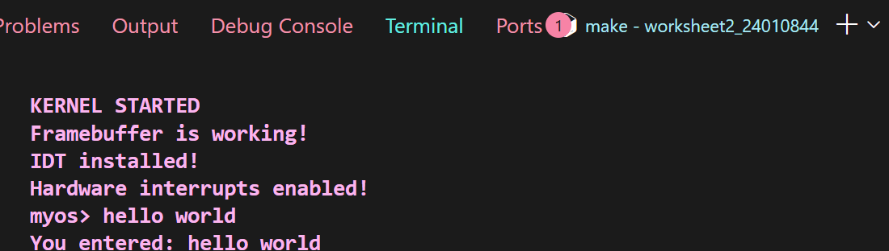

### Backspace Handling

I added Backspace functionality so that users could correct their input before pressing Enter. When Backspace is pressed, the previous character is removed from the display and the input buffer is updated.

I tested this by entering "hello world" and deleting the final two characters. The program correctly returned "hello wor".

**SS17 – Backspace testing**

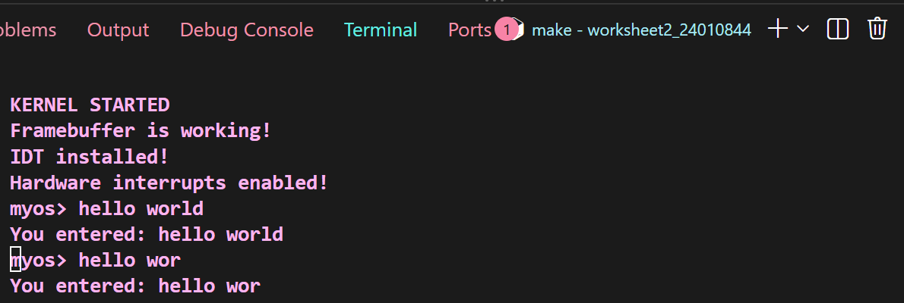

### Keyboard Interrupt Handler

The keyboard interrupt handler processes the scan codes received from the keyboard and converts them into ASCII characters.

Regular characters are added to the input buffer and displayed on the framebuffer. Backspace and Enter are handled separately so that the input can be edited and completed correctly.

The interrupt is acknowledged using `pic_acknowledge()` after the keyboard input has been processed.

**SS22 – Keyboard interrupt processing**

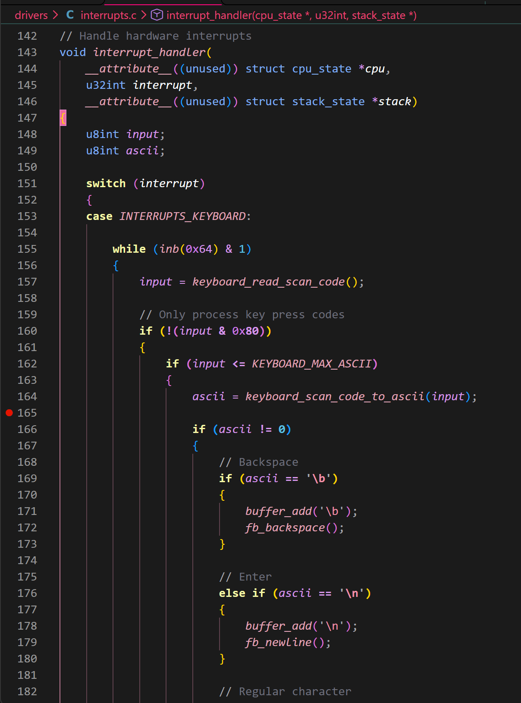

**SS23 – Character display and interrupt acknowledgement**

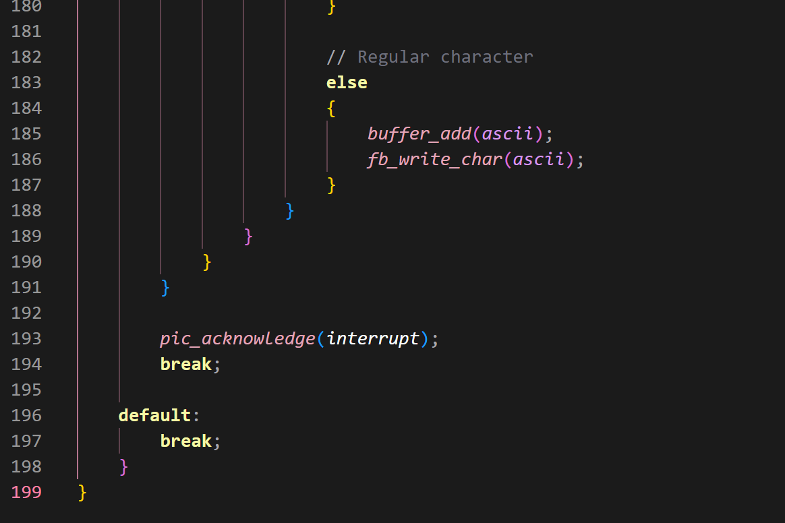

---

## Task 2 – Input Buffer API

For Task 2, I created an input buffer API to allow keyboard characters to be stored and retrieved by other parts of the operating system.

This was important because the keyboard interrupt handler receives individual characters, but the kernel needs a way to read and process complete lines of input.

### Input Buffer and Buffer Size

I created a circular input buffer in `drivers/interrupts.c` with a size of 256 characters. It uses a read index and a write index to keep track of where characters are retrieved and stored.

The `buffer_add()` function adds new characters to the buffer and checks whether it is full before storing them. This helps prevent unread characters from being overwritten.

I also tested longer inputs to check that the operating system could handle them without crashing. The `readline()` function uses the size provided to prevent writing beyond the allocated character array.

**SS18 – Long input and buffer size testing**

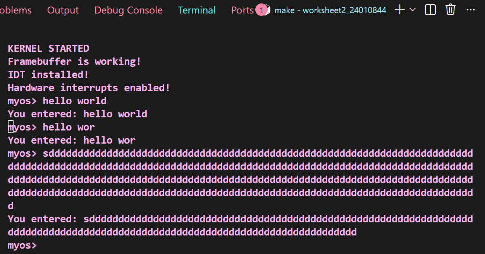

**SS19 – Circular input buffer implementation**

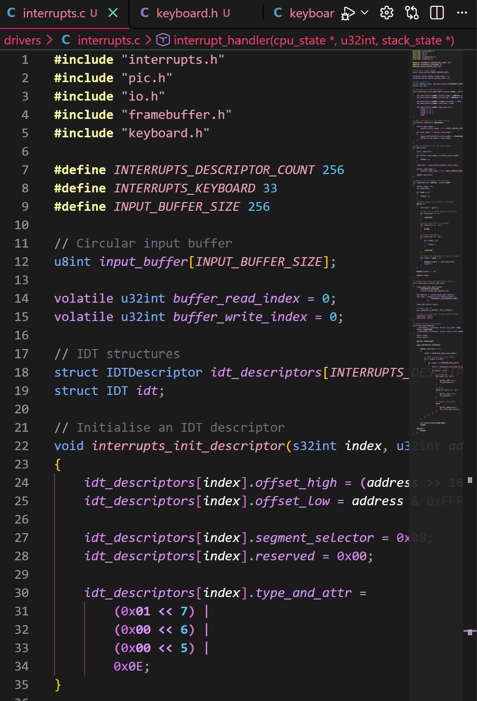

### getc() Function

I implemented the `getc()` function to retrieve one character at a time from the input buffer.

It checks whether the buffer is empty and returns `-1` if there are no characters available. Otherwise, it retrieves the next character and moves the read index forward.

The read index uses circular indexing so that it returns to the beginning of the buffer when it reaches the end.

**SS20 – getc() implementation**

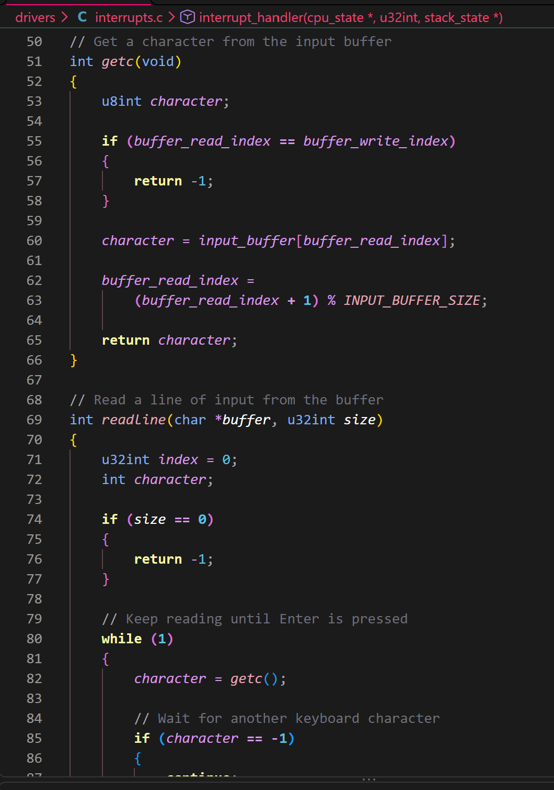

### readline() Function

The `readline()` function uses `getc()` to read characters from the input buffer until the Enter key is pressed. It stores the characters in a supplied character array and returns the length of the completed input.

I also included Backspace handling and a size check to prevent the function from writing beyond the available space. A null terminator is added at the end of the string.

**SS21 – readline() implementation**

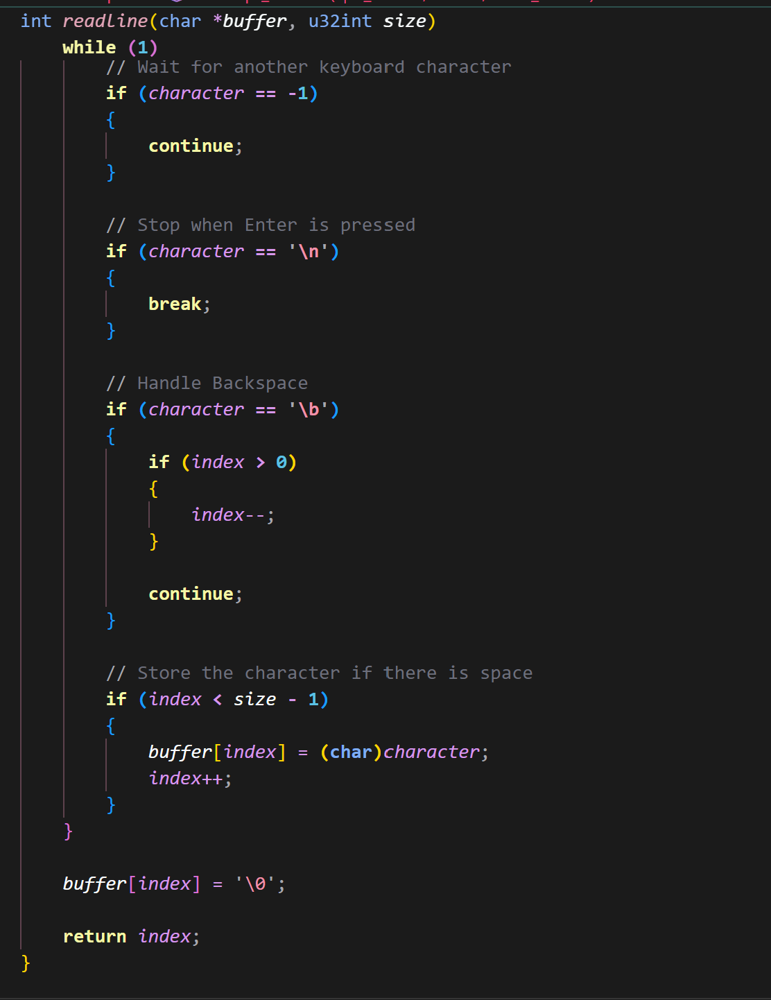

### Synchronisation

As the keyboard interrupt handler and the input functions both access the input buffer, I needed to consider how to prevent them from interfering with each other.

I used `cli` inside `getc()` to temporarily disable hardware interrupts while the buffer was being accessed. The previous processor flags are saved before this happens and restored afterwards using `popfl`.

This creates a critical section, preventing the keyboard interrupt handler from interrupting the buffer-reading operation.

This approach is suitable for the current single-CPU setup of my operating system.

**SS24 – Synchronisation testing**

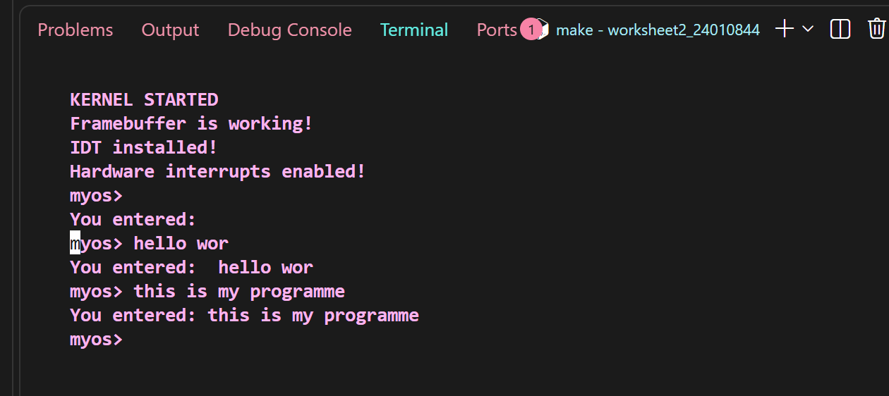

### Testing and Results

I tested the input functionality using QEMU to make sure the different features worked correctly.

| Test | Expected result | Outcome |
|---|---|---|
| Entering normal characters | Characters appear on screen | Passed |
| Pressing Enter | Completes the input line | Passed |
| Using Backspace | Removes the previous character | Passed |
| Retrieving characters using `getc()` | Returns the next character | Passed |
| Reading complete lines using `readline()` | Returns the completed input | Passed |
| Testing longer input | Respects the supplied buffer size | Passed |
| Testing after synchronisation changes | Keyboard input continues working | Passed |

The tests showed that the operating system could accept keyboard input, allow the user to edit it and return completed lines correctly. The operating system continued running during the tests.

---

## Task 3 – Terminal Implementation

For Task 3, I extended my operating system by creating a basic command-line terminal. This allows users to enter commands through the keyboard and receive different outputs depending on what they enter.

I used the keyboard input and framebuffer functionality that I had already implemented in the previous tasks. The terminal displays a `myos>` prompt and waits for the user to enter a command.

### Command Structure and Function Pointers

I created a command structure in `kernel.c` to store the name of each command and the function that should be executed when it is entered.

I used a function pointer called `command_function`, which allows different functions to be called depending on the command entered.

I then created a command table containing four commands: `help`, `echo`, `clear` and `version`.

**SS30 – Command structure and function pointer**

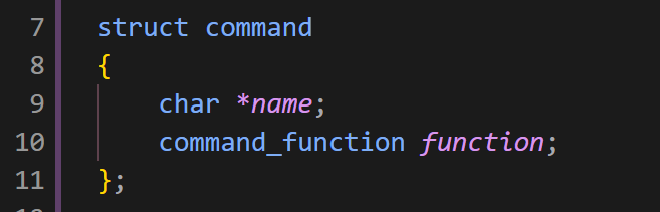

**SS31 – Command table containing the available commands**

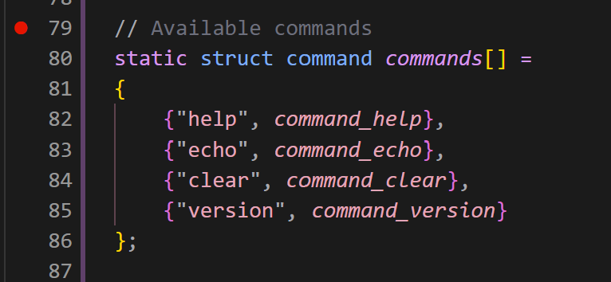

### Comparing and Parsing Commands

I created a function called `strings_equal()` to compare the command entered by the user with the names stored in the command table.

The function compares each character in the two strings. It returns 0 if the strings are different and returns 1 if they match.

**SS32 – String comparison function**

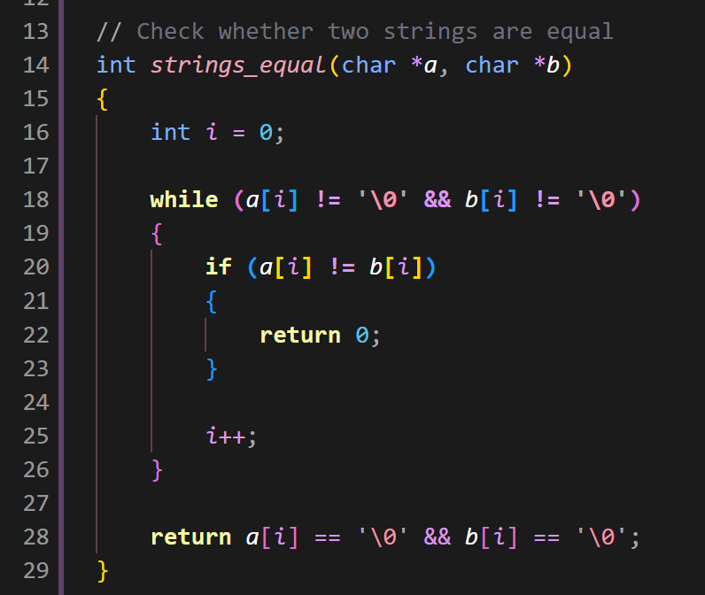

I then created `execute_command()` to process the user's input. It first removes any leading spaces and checks whether the input is empty.

The function then separates the command from its arguments by finding the first space in the input. This allows commands such as `echo hello world` to be processed correctly.

It searches through the command table and uses the matching function pointer to execute the correct command. I also used `sizeof()` to calculate the number of commands automatically, so I do not need to manually change the loop limit when adding another command.

If the command is not recognised, the terminal displays an unknown-command message.

**SS33 – Command parsing and separating arguments**

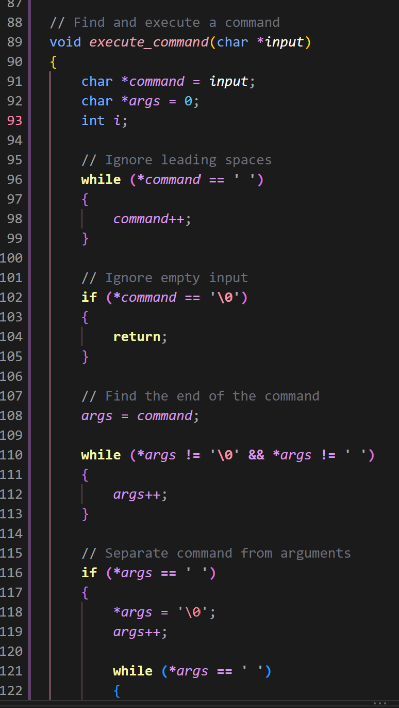

**SS34 – Searching for commands and executing functions**

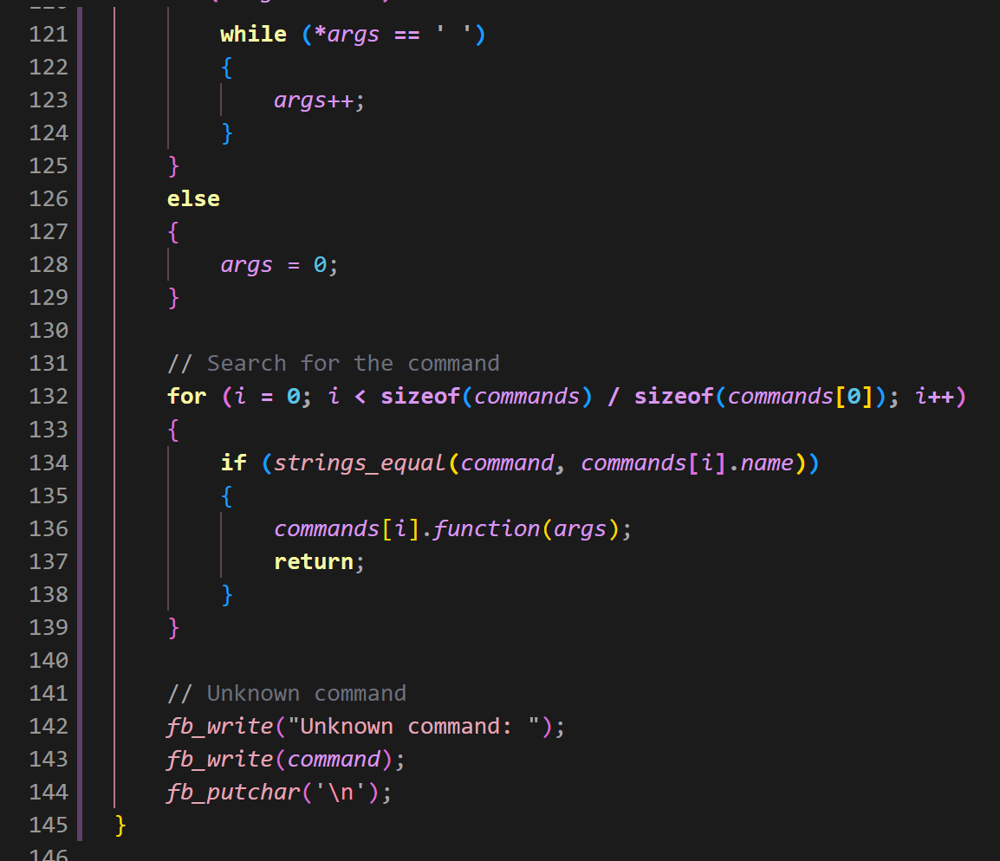

### Implementing the Terminal

I updated `kernel_main()` to run the terminal in a continuous loop. The kernel displays the `myos>` prompt, uses `readline()` to collect the user's input and then passes the completed input to `execute_command()`.

This means the terminal can continue accepting commands until the operating system is stopped.

**SS35 – Kernel initialisation and terminal loop**

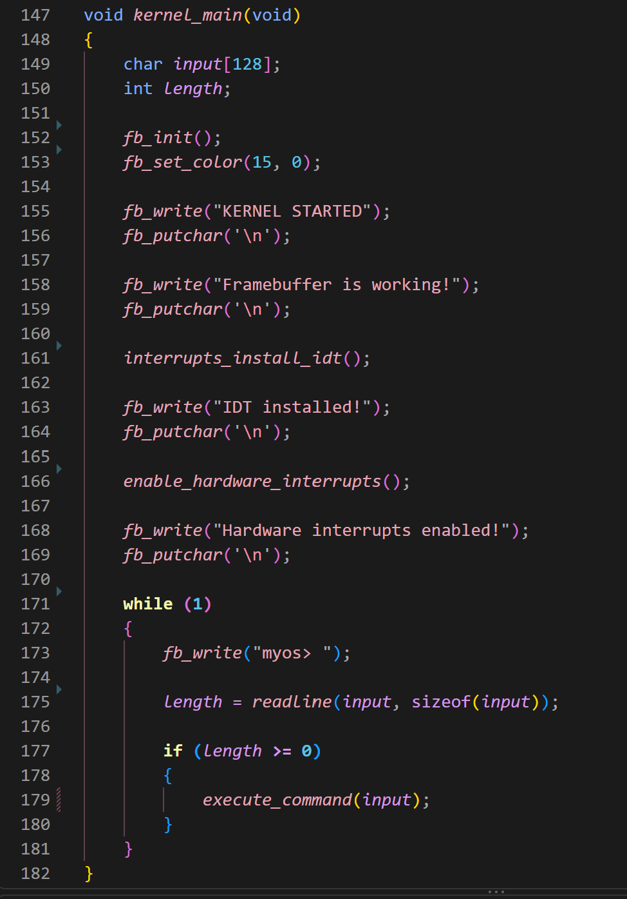

### Terminal Commands

I implemented four commands to demonstrate the terminal functionality.

| Command | Description |
|---|---|
| `help` | Displays a list of available commands and their descriptions. |
| `echo [text]` | Displays the text entered after the command. |
| `clear` | Clears the framebuffer screen. |
| `version` | Displays the operating system name and version. |

The `help` command makes it easier to see which commands are available. The `echo` command displays the arguments entered by the user, while `clear` uses my existing framebuffer clear function. The `version` command displays the name and version of my operating system.

### Testing the Terminal

I tested the terminal using QEMU to check that the commands were being recognised and executed correctly.

I also tested different inputs to check how the terminal handled empty commands, multiple spaces and commands that were not recognised.

**SS25 – Testing help, echo, unknown commands and empty input**

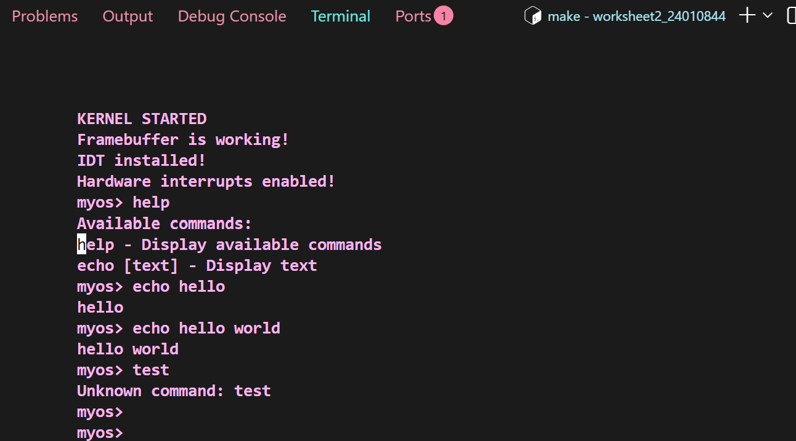

**SS26 – Testing the clear command**

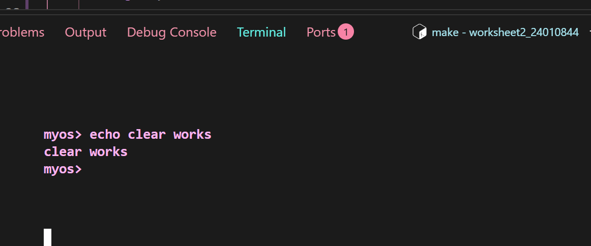

**SS27 – Testing the version command**

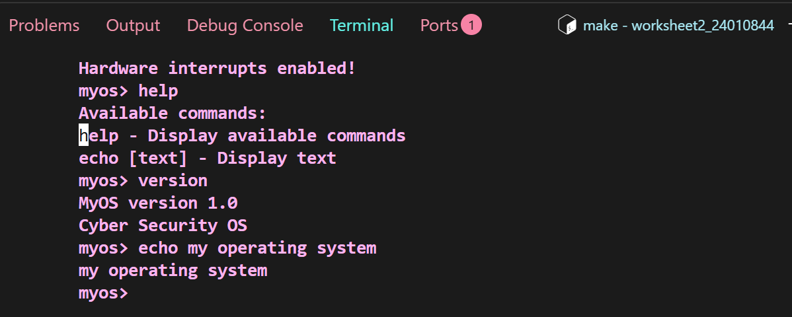

**SS28 – Updated help menu displaying all four commands**

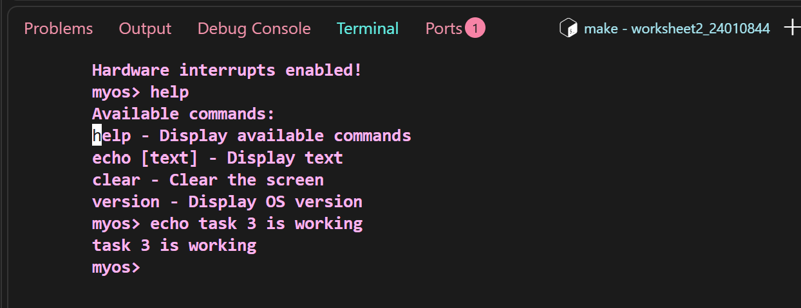

| Test | Expected result | Outcome |
|---|---|---|
| Entering `help` | Displays the available commands | Passed |
| Entering `echo hello` | Displays `hello` | Passed |
| Entering `clear` | Clears the screen | Passed |
| Entering `version` | Displays OS version information | Passed |
| Entering an unknown command | Displays an error message | Passed |
| Pressing Enter without input | Returns to a new prompt | Passed |
| Entering `echo` without arguments | Displays an empty line | Passed |
| Entering `echo` with multiple spaces | Displays the supplied text | Passed |

**SS29 – Testing empty input, echo and unknown commands**

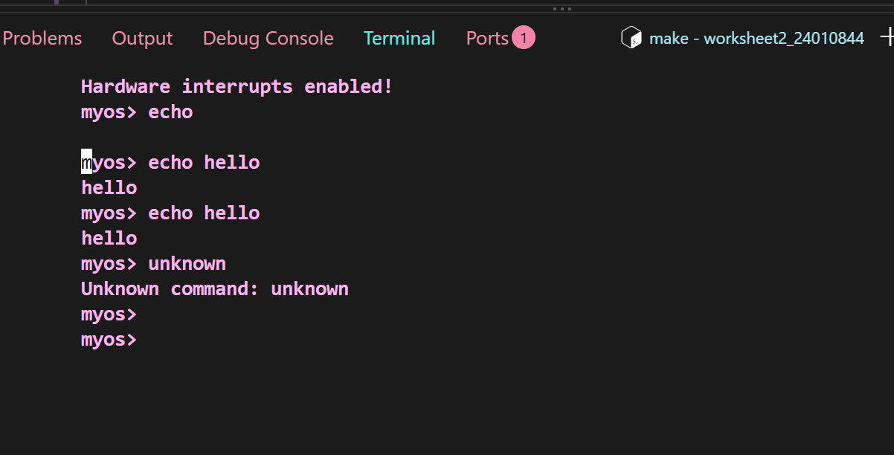

The tests showed that the terminal could accept keyboard input, separate commands from their arguments and execute the correct functions. It also handled empty input and unknown commands without stopping the operating system.

---

## Conclusion

Overall, this worksheet helped me understand more about how an operating system works at a basic level. I created a bootloader, used Assembly and C together, built a framebuffer driver and implemented keyboard input using hardware interrupts.

I also developed an input buffer and created a basic terminal that can recognise and execute commands such as help, echo, clear and version. Testing each part using QEMU helped me understand how the different components work together.

I gained more experience using Assembly, C, Linux, Make, Git and QEMU throughout the worksheet.