# Operating Systems – Worksheet 2 Part 1

## Introduction

For this worksheet, I worked on building a small operating system using Assembly and C. The main aim was to understand how an operating system starts up, how Assembly and C work together, and how text can be displayed using a framebuffer.

I completed the work using the UWE CSCT Cloud environment. The main tools I used were NASM, GCC, Make and QEMU.

### Project Structure

I organised my project into a few different folders to keep the files separate and easier to manage.

- `source` contains the Assembly loader, kernel, C functions and linker script.
- `drivers` contains my framebuffer driver.
- `iso` contains the GRUB files needed to boot the operating system.
- `Makefile` contains the commands used to compile and build the operating system.

**SS1 – Project structure**

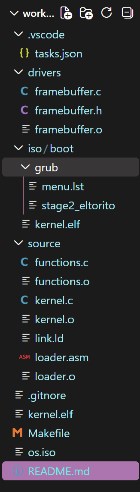

---

# Task 1 – Starting a Tiny Operating System

For Task 1, I started by creating the basic files needed to boot my operating system. This included the Assembly bootloader, linker script, GRUB configuration and Makefile.

The bootloader is responsible for starting the operating system. I added a Multiboot header containing a magic number, flags and checksum so that GRUB could recognise the kernel.

I also needed to set up a stack before calling the C kernel. The following code shows how I did this:

```asm
mov esp, stack_top
cld
call kernel_main
```

Setting up the stack allows the C code to run correctly. I also created a linker script to organise where the kernel is placed in memory.

I then updated the Makefile so that it could compile the files, link the kernel and create a bootable ISO image.

### Evidence

**SS2 – My Assembly bootloader**

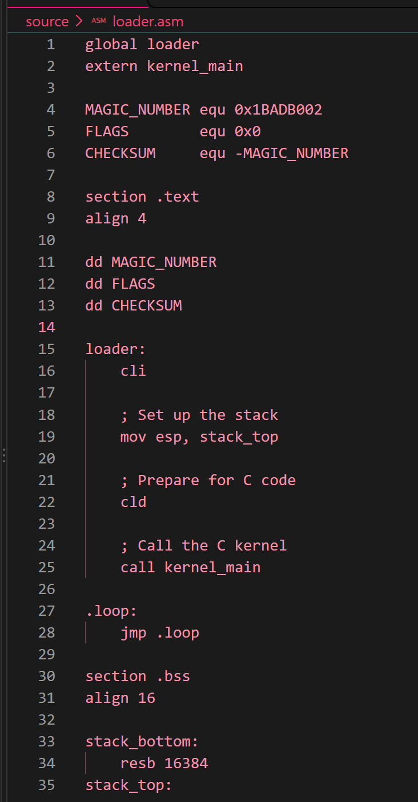

**SS3 – Building the kernel and ISO**

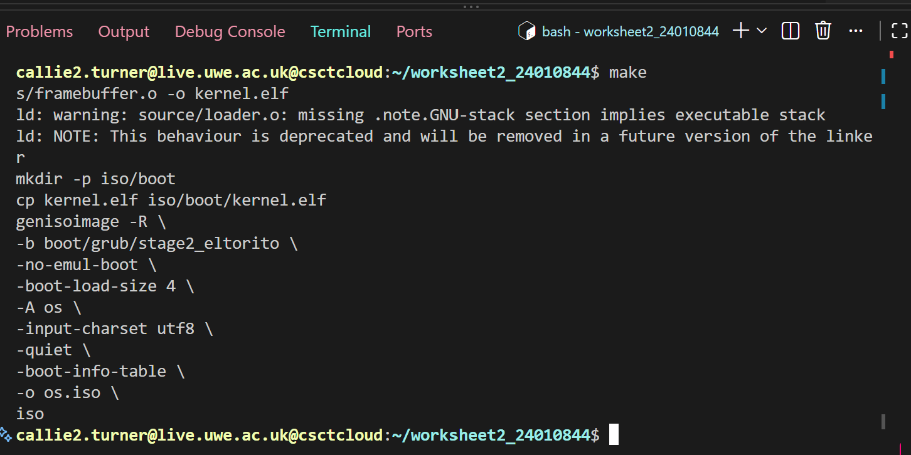

---

# Task 2 – Calling C from Assembly

For Task 2, I extended my operating system so that it could run C functions as well as Assembly code.

I updated the Makefile to use GCC to compile the C files and link them with my Assembly loader.

I created a file called `functions.c` which contains three functions:

- `sum_of_three()` adds three numbers together.
- `multiply_two()` multiplies two numbers.
- `find_largest()` finds the largest number out of three values.

For example, my `find_largest()` function starts by assuming that the first number is the largest. It then compares the other two numbers and updates the value if it finds a bigger one.

```c
int find_largest(int a, int b, int c)
{
    int largest = a;

    if (b > largest)
        largest = b;

    if (c > largest)
        largest = c;

    return largest;
}
```

I tested all three functions to make sure they were returning the correct answers.

The results were:

| Function | Numbers used | Result |
|---|---|---:|
| Sum | 10, 20, 30 | 60 |
| Multiply | 5, 6 | 30 |
| Largest | 15, 40, 25 | 40 |

All three functions returned the expected results.

### Evidence

**SS4 – The three C functions in `functions.c`**

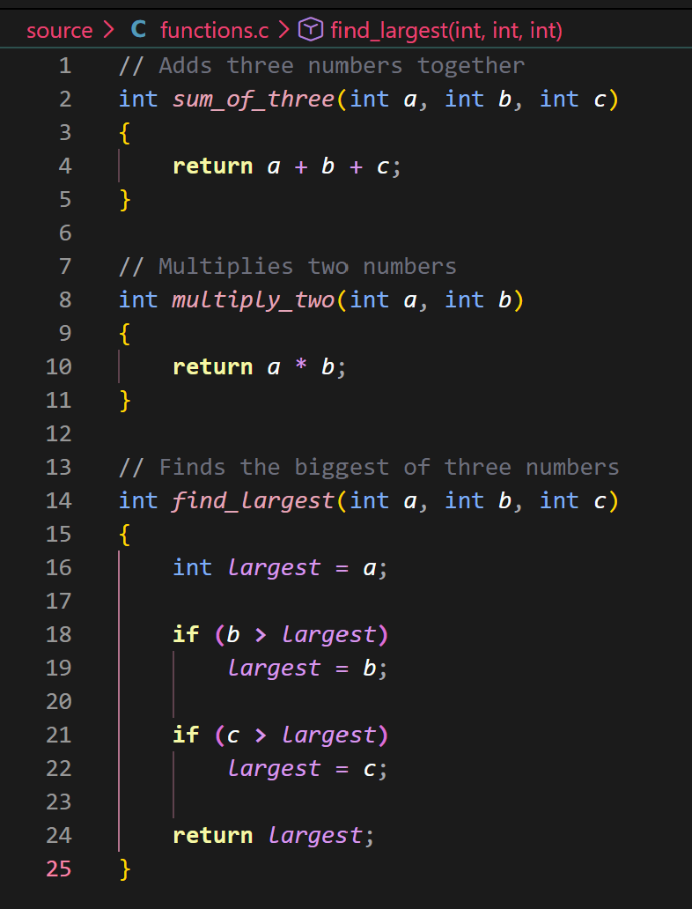

**SS5 – Testing the C functions**


---

# Task 3 – Framebuffer Driver

For Task 3, I moved on to adding input and output functionality to my operating system. I focused on the framebuffer, which allows text to be displayed on the screen.

A framebuffer uses memory-mapped I/O. This means that data can be written to a specific memory address to update what is displayed.

The framebuffer address I used was:

```c
0x000B8000
```

The screen is set up as 80 columns by 25 rows. Each position stores a character and information about its colour.

## Creating the Framebuffer API

I created two files inside my `drivers` folder:

- `framebuffer.c` contains the actual functions.
- `framebuffer.h` contains the function declarations so that the kernel can use them.

I included several functions to allow the kernel to control what appears on the screen.

| Function | What it does |
|---|---|
| `fb_init()` | Sets up the framebuffer |
| `fb_move(x, y)` | Moves the cursor to a chosen position |
| `fb_putchar(c)` | Prints one character |
| `fb_write(text)` | Prints a string |
| `fb_write_dec(number)` | Prints a decimal number |
| `fb_set_color(fg, bg)` | Changes the text and background colours |
| `fb_clear()` | Clears the screen |

**SS6 – Framebuffer header file**

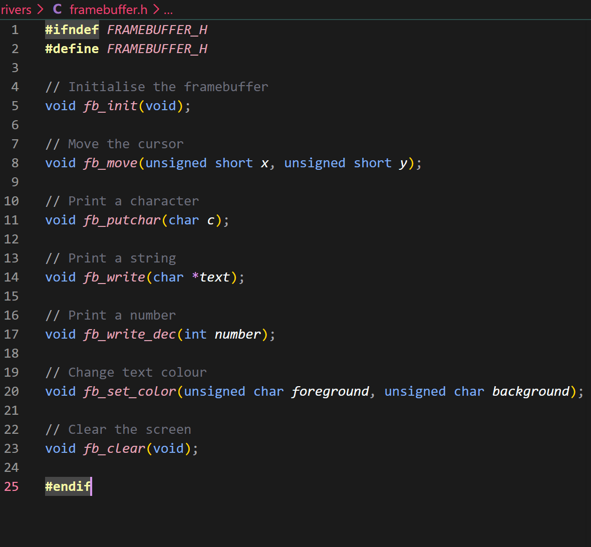

## How the Framebuffer Works

To access the framebuffer, I created a pointer to its memory address:

```c
volatile unsigned short *fb =
    (unsigned short *)0x000B8000;
```

I used `volatile` because the framebuffer is connected to hardware, so I don't want the compiler to assume that its contents will never change.

When printing a character, I needed to combine the character with its colour information before writing it to the correct position in memory.

```c
fb[position] = ((unsigned short)colour << 8) | c;
```

This allows both the character and its colour to be displayed.

## Moving the Cursor and Changing Colours

I created `fb_move()` to allow the cursor to be moved using x and y coordinates.

```c
void fb_move(unsigned short x, unsigned short y)
{
    if (x < FB_WIDTH && y < FB_HEIGHT)
    {
        cursor_x = x;
        cursor_y = y;
    }
}
```

I added a check to make sure the cursor stays within the screen boundaries.

I also created `fb_set_color()` so that I could change the foreground and background colours of the text.

**SS7 – Framebuffer memory, cursor variables and colour settings**

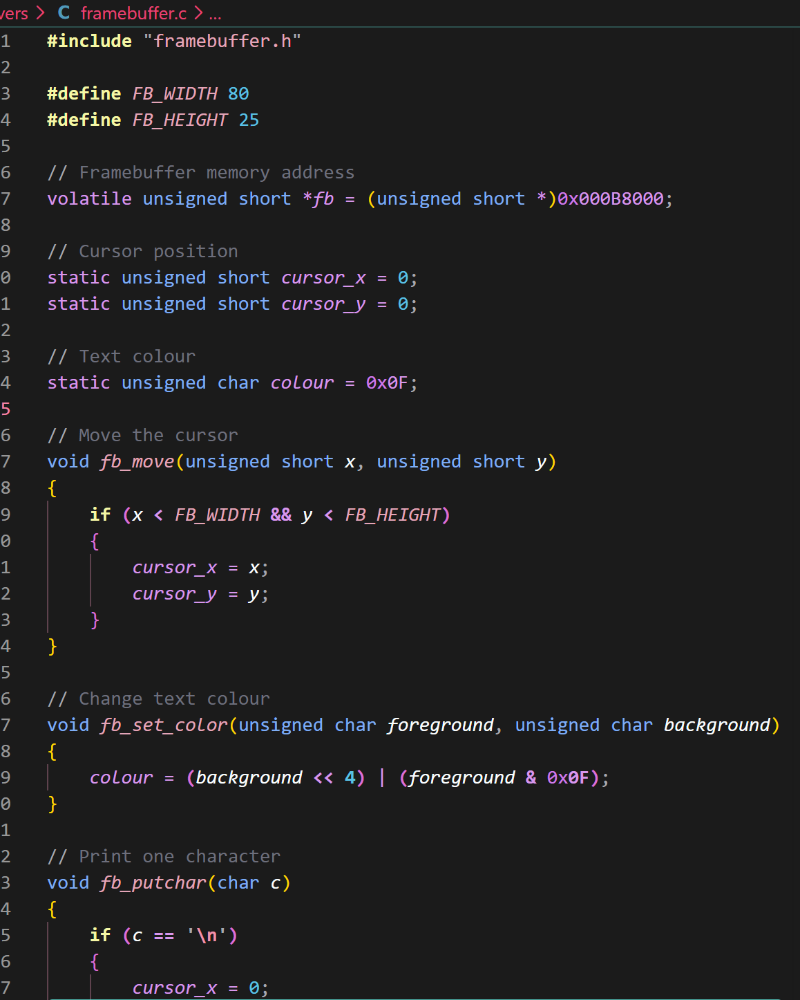

## Printing Characters, Strings and Numbers

I created `fb_putchar()` to print individual characters to the screen.

I then used this function inside `fb_write()` so that I could print whole strings rather than having to print each character separately.

**SS8 – Printing characters and strings**

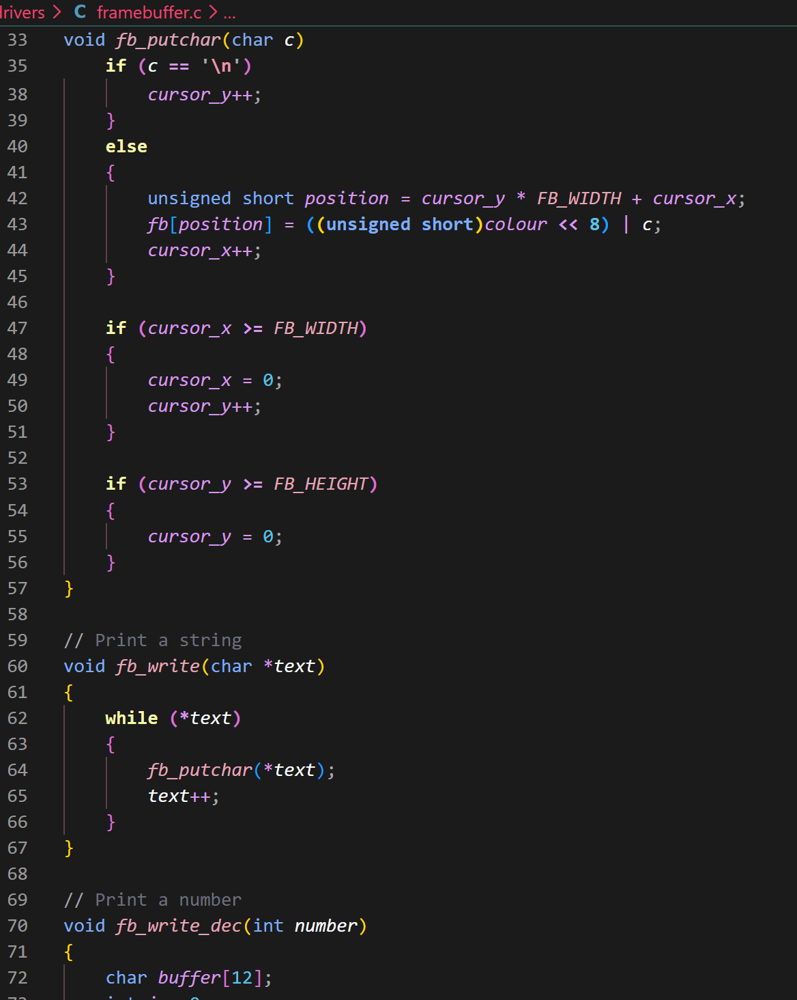

I also added `fb_write_dec()` to allow numbers to be displayed. This works by taking each digit from the number and converting it into a character before printing it.

**SS9 – Number printing and clearing the framebuffer**

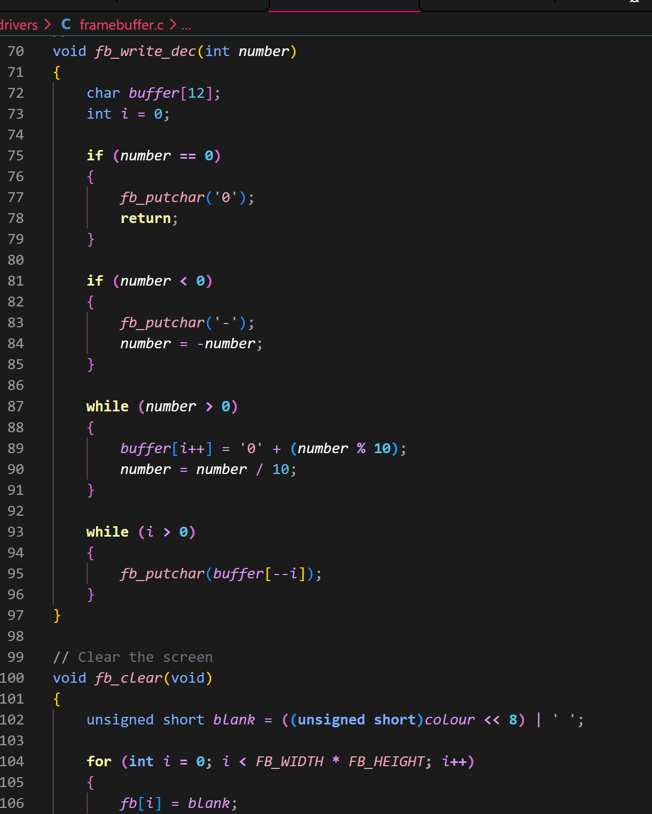

## Clearing and Initialising the Screen

I created `fb_clear()` to clear the screen by writing blank spaces to all 2,000 positions in the framebuffer. It also resets the cursor back to the top-left corner.

The `fb_init()` function sets the default text colour and calls `fb_clear()` when the framebuffer is first started.

**SS10 – The clear and initialise functions**

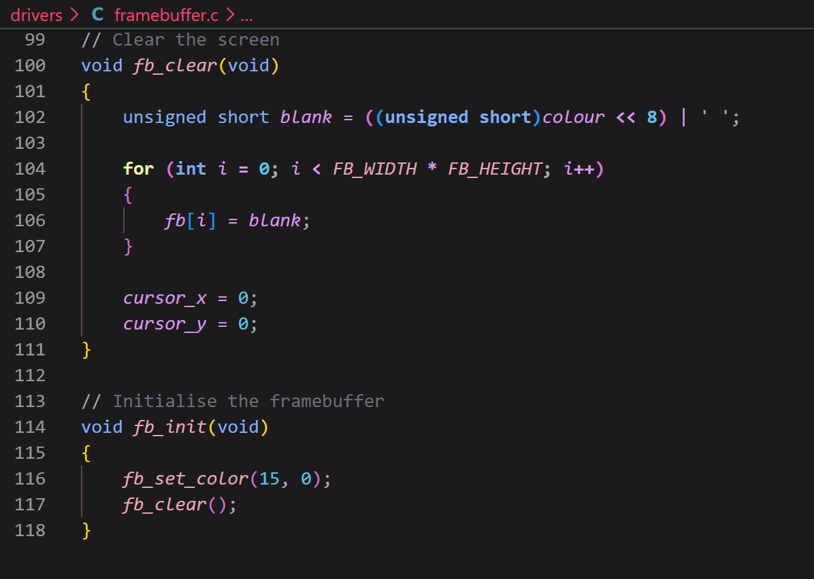

## Testing the Framebuffer

Once I had finished the driver, I updated `kernel.c` to test the different functions.

I used the kernel to display a heading, messages, numbers and text in different colours. I also tested moving the cursor to position `(10, 10)`.

I called my three C functions from Task 2 again to make sure they still worked with the framebuffer driver.

**SS11 – Initialising the framebuffer and testing text, colours and cursor positioning**

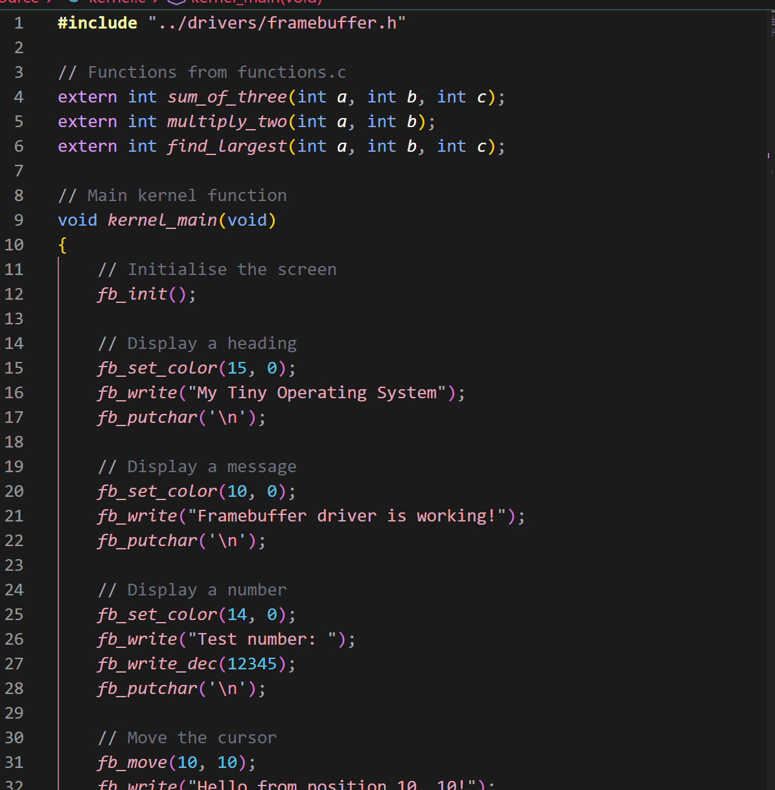

**SS12 – Calling the C functions and displaying their results**

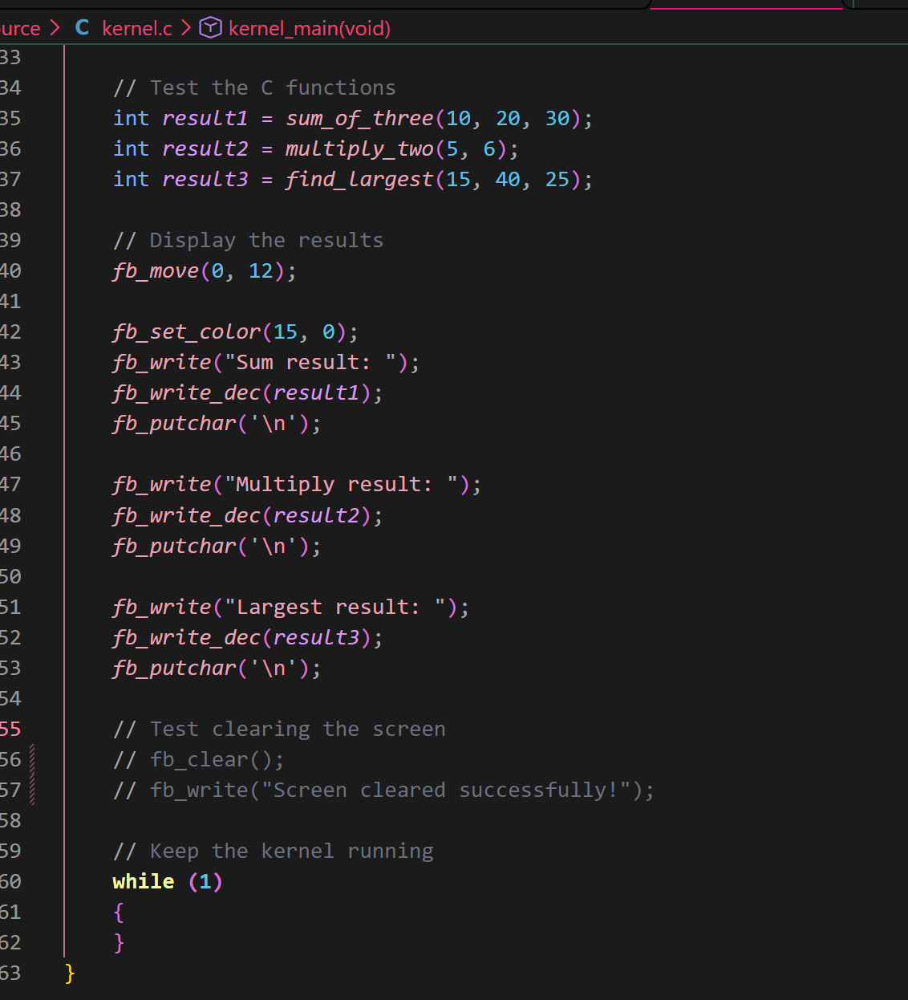

## Running the Operating System in QEMU

I updated my Makefile to include the framebuffer driver when compiling and linking the kernel.

I also changed the QEMU command to use Curses mode, as requested in the worksheet. This allowed the operating system to display text in the terminal.

I configured a Telnet monitor on port `45454`, which allowed me to connect to QEMU through another terminal. I could then use the `quit` command to close the emulator.

When testing the framebuffer, I got the following results:

- Sum result: 60
- Multiply result: 30
- Largest result: 40

**SS13 – QEMU displaying the framebuffer test results**

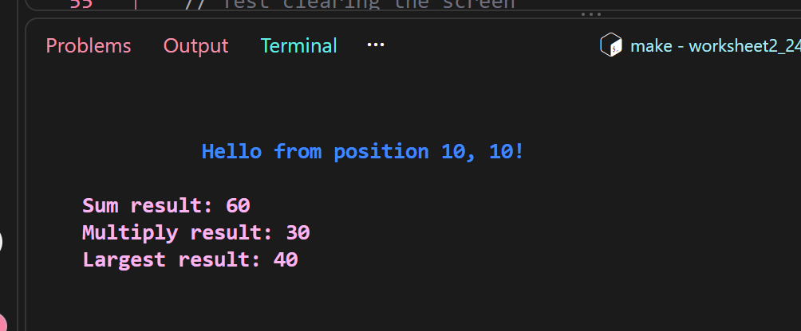

I also tested the clear-screen function by calling `fb_clear()` and then printing a new message. This successfully removed the previous text and displayed the new message.

**SS14 – Testing the clear-screen function**

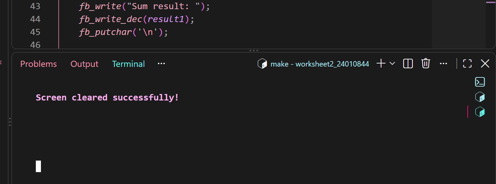

---

# Task 4 – README and GitHub

For the final task, I documented the work I had completed in this README. I included explanations of how the main parts of the operating system work, some short code examples and screenshots of my progress.

I used Git to keep track of my changes and pushed my completed work to my GitHub repository on the `main` branch.

**SS15 – My GitHub repository showing the project files and commits**

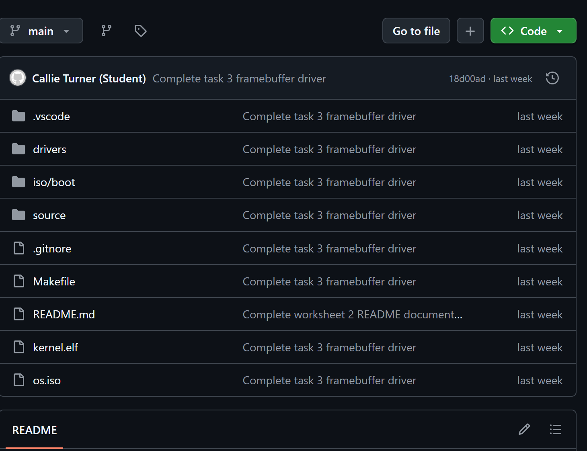

---

## Conclusion

Overall, this worksheet helped me understand more about how an operating system works at a basic level. I was able to create a bootloader, get my kernel working with C functions and build a framebuffer driver to display text.

I also got more experience using Assembly, C, Linux, Make and QEMU. Testing each part as I went along helped me check that the different parts of my operating system were working together.